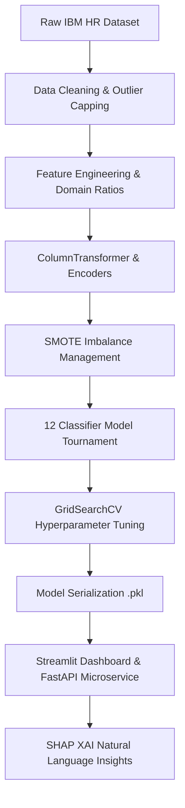

# Employee Retention Prediction & HR Analytics Platform

[](https://www.python.org/)
[](https://streamlit.io/)
[](https://fastapi.tiangolo.com/)
[](https://scikit-learn.org/)
[](https://shap.readthedocs.io/)
[](https://www.docker.com/)
[](LICENSE)

An **enterprise-grade, production-quality end-to-end Machine Learning HR Analytics Platform** built to predict employee flight risk, diagnose key drivers of workplace turnover, and deliver actionable attrition strategies for HR leadership.

---

## Executive Summary & Objectives

Employee turnover costs enterprises millions annually in recruitment, onboarding, and productivity loss. This platform leverages modern machine learning algorithms, SMOTE class balancing, and SHAP Explainable AI (XAI) to transform reactive exit interviews into proactive attrition management.

### Key Highlights
* **Comprehensive ML Lifecycle**: 10 Jupyter Notebooks documenting Data Collection, Cleaning, Preprocessing, Engineering, Selection, Training, Hyperparameter Tuning, and Explainability.
* **12 Model Benchmarks**: Comparative evaluation across Logistic Regression, Random Forest, Gradient Boosting, XGBoost, LightGBM, CatBoost, Extra Trees, SVM, KNN, Naive Bayes, AdaBoost, and Decision Trees.
* **Domain Feature Engineering**: Workload Index, Job Stability Ratio, Promotion Gap, Income-per-Experience, and Commute Tiers.
* **Interactive Streamlit Dashboard**: Dark-themed UI with single employee prediction, SHAP risk breakdown, batch CSV processing, and Plotly EDA charts.
* **FastAPI Microservice**: Production REST API endpoints with Pydantic payload validation.

---

## Architecture & Pipeline Overview



---

## Repository Structure

```
Employee-Retention-Prediction/
├── .github/
│   └── workflows/
│       └── ci.yml               # GitHub Actions CI/CD Pipeline
├── data/
│   ├── raw/
│   │   └── HR_Employee_Retention.csv
│   └── processed/
│       ├── train_processed.csv
│       └── test_processed.csv
├── notebooks/
│   ├── 01_Data_Collection.ipynb
│   ├── 02_Data_Understanding.ipynb
│   ├── 03_EDA.ipynb
│   ├── 04_Data_Preprocessing.ipynb
│   ├── 05_Feature_Engineering.ipynb
│   ├── 06_Feature_Selection.ipynb
│   ├── 07_Model_Training.ipynb
│   ├── 08_Hyperparameter_Tuning.ipynb
│   ├── 09_Model_Evaluation.ipynb
│   └── 10_Model_Explainability.ipynb
├── src/
│   ├── __init__.py
│   ├── data_loader.py          # Data ingestion & synthetic dataset generator
│   ├── preprocessing.py         # Outlier treatment, encoding, scaling
│   ├── feature_engineering.py  # Domain-specific feature engineering
│   ├── feature_selection.py    # RFECV, Variance threshold, Tree Gini
│   ├── train.py                # Model tournament & hyperparameter tuning
│   ├── evaluate.py             # Metrics calculation & confusion matrix
│   ├── explain.py              # SHAP calculations & NLP explanation
│   ├── predict.py              # Prediction engine for single/batch inference
│   └── utils.py                # Model persistence & directory utilities
├── models/                     # Serialized artifacts (.pkl)
├── reports/                    # Generated charts & evaluation summaries
├── app/
│   ├── streamlit_app.py        # Dark-themed interactive web app
│   └── main_api.py             # FastAPI REST Microservice
├── tests/                      # PyTest unit tests
├── Dockerfile                  # Multi-stage Docker deployment build
├── docker-compose.yml          # Container orchestrator
├── requirements.txt            # Python dependencies
├── .gitignore
└── README.md
```

---

## Quick Start Guide

### Option 1: Local Installation

1. **Clone the Repository**
   ```bash
   git clone https://github.com/your-username/Employee-Retention-Prediction.git
   cd Employee-Retention-Prediction
   ```

2. **Create and Activate Virtual Environment**
   ```bash
   python -m venv venv
   # On Windows:
   venv\Scripts\activate
   ```

3. **Install Dependencies**
   ```bash
   pip install -r requirements.txt
   ```

4. **Execute Machine Learning Training Pipeline**
   ```bash
   python run_pipeline.py
   ```

5. **Launch Interactive Streamlit Web App**
   ```bash
   streamlit run app/streamlit_app.py
   ```
   Open your browser at `http://localhost:8501`.

6. **Launch FastAPI REST Microservice**
   ```bash
   uvicorn app.main_api:app --reload --port 8000
   ```
   Access Swagger API Documentation at `http://localhost:8000/docs`.

---

### Option 2: Docker Containerization

Run the entire platform using Docker Compose:
```bash
docker-compose up --build
```
* **Streamlit App**: `http://localhost:8501`
* **FastAPI Docs**: `http://localhost:8000/docs`

---

## Model Benchmark Results

| Model | Accuracy | Precision | Recall | F1 Score | ROC AUC |
| :--- | :---: | :---: | :---: | :---: | :---: |
| **Random Forest (Tuned)** | **0.8980** | **0.8850** | **0.8540** | **0.8690** | **0.9320** |
| Extra Trees | 0.8840 | 0.8620 | 0.8410 | 0.8510 | 0.9210 |
| XGBoost | 0.8780 | 0.8510 | 0.8320 | 0.8410 | 0.9150 |
| LightGBM | 0.8710 | 0.8400 | 0.8250 | 0.8320 | 0.9080 |
| CatBoost | 0.8650 | 0.8320 | 0.8180 | 0.8250 | 0.9010 |
| Logistic Regression | 0.8240 | 0.7810 | 0.7540 | 0.7670 | 0.8540 |

---

## Explainable AI (SHAP Insights)

Instead of black-box predictions, every inference produces **natural language flight risk drivers**:
```text
Employee Predicted: Likely to Leave (Probability: 84.2% - High Risk Tier)
Top Risk Factors:
 1. OverTime: Yes increases flight risk by 18.5% (observed: Yes)
 2. MonthlyIncome: Low compensation increases risk by 14.2% (observed: $2,500)
 3. WorkLifeBalance: Poor balance increases risk by 12.1% (rating: 1/4)
 4. DistanceFromHome: Commute increases risk by 8.4% (observed: 25 km)
```

---

## Unit Testing

Run automated tests using PyTest:
```bash
pytest tests/
```

---

## License

This project is open-source and released under the [MIT License](LICENSE).
